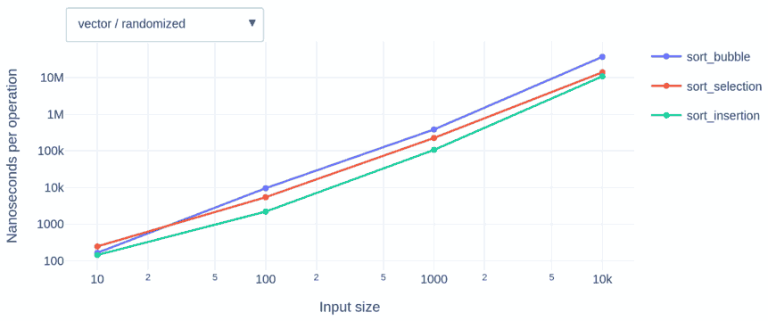

# Sorting Through Complexity

An introductory exploration of complexity theory through [open science](https://en.wikipedia.org/wiki/Open_science) and [open pedagogy](https://en.wikipedia.org/wiki/Open_pedagogy).


## Learning Outcomes

After completing this project, students will be able to:

1. Compare the [computational complexity](https://en.wikipedia.org/wiki/Computational_complexity) of sorting algorithms and list operations
2. Collaborate on software projects using [version control systems](https://en.wikipedia.org/wiki/Version_control)
3. Follow [open science](https://en.wikipedia.org/wiki/Open_science) practices and create [reproducible workflows](http://www.practicereproducibleresearch.org/core-chapters/3-basic.html)


## Project

Each student or group implements list operations and sorting algorithms as methods within C++ container classes (`list`, `forward_list`, and `vector`). These containers are used in a student-designed test harness to confirm correctness and measure wall time and the number of comparisons performed for various input sizes. The harness outputs a structured [csv](https://en.wikipedia.org/wiki/Comma-separated_values) file with these raw results. A shared web dashboard is updated to allow comparison and exploration of the included algorithms and data structures. The dashboard compares the programs in terms of both wall time and the number of operations used.

[Example Dashboard](https://jncraton.github.io/sorting-complexity/)



Students can contribute and review one another's work using pull requests. GitHub Actions or other automated [CI/CD](https://en.wikipedia.org/wiki/CI/CD) tools can automatically build the dashboard and publish it for review.

### Tasks

Students implement the following methods on a custom [dynamic array](https://en.wikipedia.org/wiki/Dynamic_array), [linked list](https://en.wikipedia.org/wiki/Linked_list), and [doubly linked list](https://en.wikipedia.org/wiki/Doubly_linked_list) along the lines of a [SequenceContainer](https://en.cppreference.com/cpp/named_req/SequenceContainer):

- Container access and modification methods
  - at
  - []
  - insert
  - clear
  - front
  - back
  - push_back
  - pop_back
  - push_front
  - pop_front
- Sorting methods
  - sort_bubble
  - sort_insertion
  - sort_selection
  - sort_merge
  - sort_quick
  - sort_heap
  - sort_shell
  - sort_tim

## Example Code

Example code that an be used as a starting point is provided in a [Github repository](https://github.com/jncraton/sorting-complexity).

### Building

Running the included `makefile` will build all files, run analysis and generate the dashboard (`index.html`). To build the dashboard locally, you'll need Python 3.12, uv, make, and gcc 14.2 or higher. Simply run:

```sh
make
```

### Analysis

The following automated analysis is performed and displayed for each container and operation:

1. The containers are compiled using `g++ -std=c++23`.
2. The `bench` program measures the time taken for various operations (e.g., `push_back`, `insert`, `sort_quick`) across different input sizes.
3. A `TrackedInt` class is used to count the number of comparisons performed during sorting.
4. The results are saved to `bench.csv`.
5. `analyze.py` processes the CSV to generate an interactive Plotly dashboard (`index.html`) comparing performance across containers and algorithms.

## OCTOPUS and PALSave

This open resource is part of the [OCTOPUS project](https://qubeshub.org/community/groups/octopus/about) and supported by a [PALSave Open Pedagogy grant](https://palni.org/palsave/open-pedagogy-grants).
